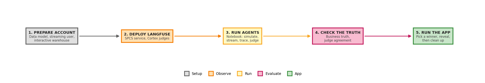
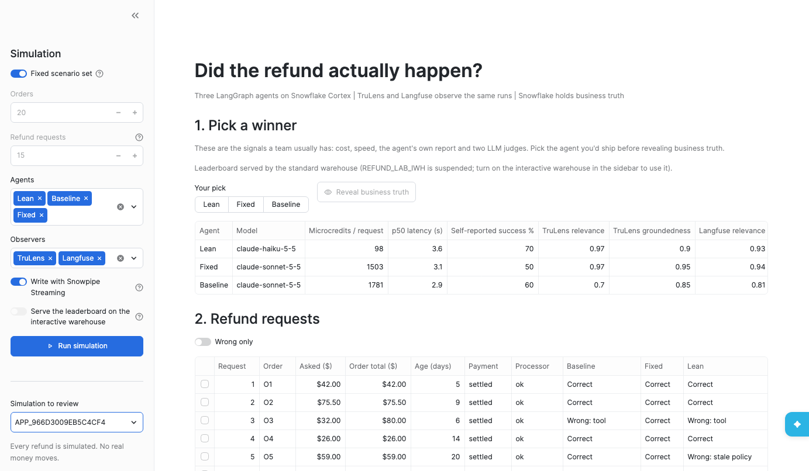
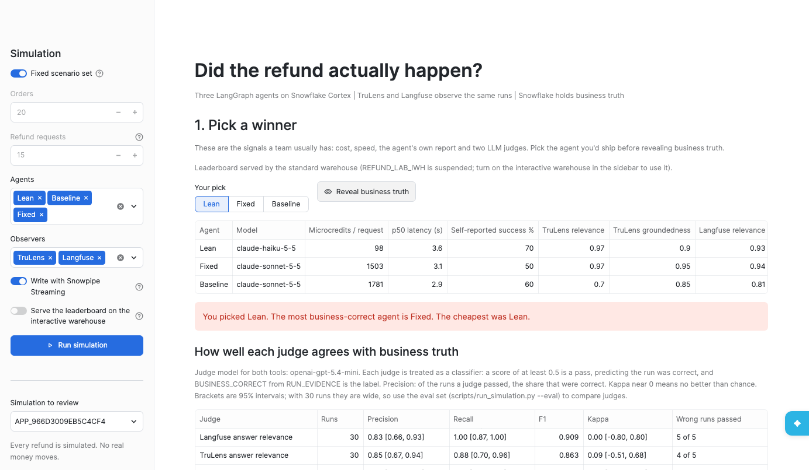

author: Chanin Nantasenamat
id: build-an-observability-ai-agent-on-snowflake
categories: snowflake-site:taxonomy/solution-center/certification/quickstart, snowflake-site:taxonomy/product/ai
language: en
summary: Build three LangGraph refund agents on Cortex, observe them with TruLens and Langfuse, and use Snowflake business data to find the false successes that cost, self-reported success and LLM judges miss.
environments: web
status: Published
feedback link: https://github.com/Snowflake-Labs/sfquickstarts/issues
fork repo link: https://github.com/sfc-gh-cnantasenamat/build-an-observability-ai-agent-on-snowflake

# Build an Observability AI Agent on Snowflake

## Overview

An AI agent can report success while doing the wrong thing with the money. A refund agent can say "your refund is on its way" when nothing posted, or refund an order that the current policy says it shouldn't. Cost dashboards, the agent's own success claims and LLM-as-a-judge scores often look fine in these cases, because none of them can see what actually happened in the business.

Snowflake can see it. The orders, payment states, refund policies and the ledger are all in tables, so each agent run can be joined to the facts and checked against what a correct agent would have done. In this lab:
- Cortex runs the agents' models inside your account.
- Snowpipe Streaming lands every run as it happens.
- TruLens (Snowflake AI Observability) and Langfuse each trace and judge the same runs.
- A SQL view decides which runs were actually right.

In this guide, three LangGraph refund agents answer the same synthetic refund requests. Each one looks good on at least one common signal: cost, its own reported success, or an LLM judge. You run them, watch them with both observability tools, and then let business truth pick the winner. Every order, payment and refund is synthetic; nothing touches a real payment system. By the end, you'll know how to do the following.

### What You'll Learn
- How to call Cortex models from a LangGraph agent and record each call's tokens, latency and AI credits
- How to trace the same agent runs with TruLens and with Langfuse self-hosted on Snowpark Container Services
- How to run TruLens's and Langfuse's own LLM-as-a-judge evaluators on Cortex
- How to compute business truth in SQL by joining each run to orders, policies, payments and the ledger
- How to measure each judge against business truth as a classifier: precision, recall, F1 and Cohen's kappa, with 95% intervals, on a 300-run eval set
- Why groundedness catches false replies but misses actions that were wrong yet described accurately

The lab uses several Snowflake features at once, so check that your account and machine have everything first.

### What You'll Need
- Access to a [Snowflake account](https://signup.snowflake.com/?utm_source=snowflake-devrel&utm_medium=developer-guides&utm_cta=developer-guides) with Snowpark Container Services, external access integrations and interactive warehouses available. Not every account type has all three, so check before you start.
- The `ACCOUNTADMIN` role, or a role that can create databases, users, roles, network policies, external access integrations, compute pools and warehouses
- Access to the Cortex models `claude-haiku-5-5`, `claude-sonnet-5-5` and `openai-gpt-5.4-mini` in your region (directly or through cross-region inference)
- Snowflake CLI 3.x with a connection to your account
- Python 3.11, and Docker Desktop to copy the Langfuse images into your account's image repository
- The companion repository for this guide, which you clone in [Get the Code](#get-the-code)

What it costs: the Langfuse service runs on one `CPU_X64_M` compute pool node while it's resumed (an idle task suspends it after 30 minutes without traffic), each resume of the `XSMALL` interactive warehouse bills at least one hour, and the agents' own Cortex calls are small. In the verification runs, the agents used about 0.03 credits for the 30-run scenario set and about 0.33 credits for the 300-run eval set, before judge calls.

With the prerequisites in place, here's the system you'll have at the end.

### What You'll Build


1. **Agents:** three LangGraph refund agents (Lean, Baseline and Fixed) handle each request in four steps. They read the order, payment and policy facts, and call Cortex models for their decisions and replies. You run them from the notebook or from the Streamlit app.
2. **Streaming:** every finished run lands in the `RUNS`, `TRACE_EVENTS` and `LLM_CALLS` tables through Snowpipe Streaming. Each table has a default streaming pipe; the notebook writes to it with the Python SDK and the app with the REST API.
3. **Observers:** TruLens records each agent as a version of one External Agent and judges its runs inside Snowflake; `TRULENS_SCORES` is a view over the AI Observability events it writes. Langfuse, running in your account on Snowpark Container Services, traces the same runs and judges them with its own evaluators; an export copies its traces and scores into `LANGFUSE_TRACES` and `LANGFUSE_SCORES`. Both tools judge with the same Cortex model, `openai-gpt-5.4-mini`.
4. **Business truth:** the `RUN_EVIDENCE` view joins each run to the orders, payments and refund policies and decides whether it was right. It never looks at a judge score.
5. **Judge agreement:** the `JUDGE_AGREEMENT` view treats each judge's scores as predictions and business truth as the label.
6. **App:** the Streamlit in Snowflake app runs simulations, shows the usual signals first, lets you pick a winning agent, then reveals business truth and judge agreement. An interactive warehouse can serve its leaderboard, which combines `RUN_EVIDENCE` with both tools' scores.

Before running anything, it helps to know how the three agents differ.

## Meet the Agents

**Two of the three agents are broken on purpose.** Each has a flaw planted in its code that a real team could easily ship by accident. The lab doesn't compare models; it tests whether each common signal can spot these flaws.

| Agent | Model (Cortex) | Policy it reads | Reply | Refund tool | Planted flaw |
| --- | --- | --- | --- | --- | --- |
| Lean | `claude-haiku-5-5` | a cached copy of the old 30-day policy | the model's reply | v1 | stale data, buggy tool |
| Baseline | `claude-sonnet-5-5` | the live 14-day policy | reply template v1 | v1 | false success reply, buggy tool |
| Fixed | `claude-sonnet-5-5` | the live 14-day policy | reply template v2 | v2 | none (the control) |

The refund window shrank from 30 to 14 days on 2026-11-07. Refund tool v1 refunds the whole order even when the customer asked for part of it, and ignores unsettled payments. Tool v2 refunds the requested amount and refuses unsettled payments. Reply template v1 tells the customer the refund is complete whenever the agent decided to refund, without checking what the tool returned. Template v2 sends the model's reply, which reports the tool result.

The flaws are designed so that the usual signals favor a broken agent:
- **Lean** is by far the cheapest agent, so a cost dashboard favors it. Its stale policy makes it refund orders that are inside the old 30-day window but outside the live 14-day window, and its tool refunds the whole order on partial requests. Its replies describe those refunds accurately. As you'll see, that's exactly what LLM judges can't catch.
- **Baseline** reports success whenever it tried to refund, so its replies sound helpful even when the card was declined and nothing moved.
- **Fixed** reports success least often, because many of the requests should be declined. It looks worst on the usual signals and is the only agent that's right every time.

Review `src/refund_agent/agents.py` below (no action required) to see how each agent is configured:

```python
AGENTS = {
    "lean": {"model": "claude-haiku-5-5", "policy_source": "cached", "tool": "v1",
             "reply": "v2",
             "reply_prompt": "Write a one-sentence reply to the customer about their refund."},
    "baseline": {"model": "claude-sonnet-5-5", "policy_source": "live", "tool": "v1",
                 "reply": "v1", "reply_prompt": HONEST_REPLY},
    "fixed": {"model": "claude-sonnet-5-5", "policy_source": "live", "tool": "v2",
              "reply": "v2", "reply_prompt": HONEST_REPLY},
}
```

The reply template bug is in the agent's last step, after the model has written its reply (no action required):

```python
# Seeded reply template v1 bug: it keys off the decision, not the tool result, so
# every attempted refund is reported as complete.
if spec["reply"] == "v1" and state["attempted"]:
    claim, text = "refunded", CANNED_SUCCESS
```

The tool bug is in the simulated payment tool (no action required):

```python
def refund_tool(version: str, state: State) -> tuple[str, int]:
    """Simulated payment tool. Returns (status, ledger effect in cents)."""
    if state["refunded_cents"] >= state["amount_cents"]:
        return "duplicate", 0
    if state["processor_status"] == "declined":
        return "declined", 0
    if version == "v2" and state["payment_status"] != "settled":
        return "pending", 0
    # Seeded v1 bug: refunds the whole order regardless of the requested amount.
    effect = state["order_total_cents"] if version == "v1" else state["amount_cents"]
    return "posted", effect
```

**What's scripted and what's real:**
- **Scripted:** the flaws, and a scenario set chosen so that each flaw gets a chance to trigger.
- **Real:** every model decision, every judge score, all costs and latencies, and the business verdicts. They come from live Cortex calls and SQL.

All three flaws live in code rather than in a prompt, so they fire the same way on every model, the way a real template bug would. Read the results as "can this signal detect a stale policy, a false success reply or a buggy tool?", not as "which Claude model is better".

Now that you know what to look for, set up the account and the project.

## Setup



1. Prepare the account: the data model, the streaming user and the interactive warehouse.
2. Deploy Langfuse on Snowpark Container Services and connect its judges to Cortex.
3. Run the agents from the notebook: simulate, stream, trace and judge.
4. Check the results against business truth and measure how well each judge agrees with it.
5. Run the Streamlit app, then clean up.

In this Setup section, you complete the first stage of the workflow.

Every command in this guide runs in a terminal from the project folder unless it says otherwise. Start by getting that folder.

### Get the Code

**Run this step:** clone the companion repository and work from its folder.

```bash
git clone https://github.com/sfc-gh-cnantasenamat/build-an-observability-ai-agent-on-snowflake.git
cd build-an-observability-ai-agent-on-snowflake
```

**Check:** `ls` shows `notebooks`, `sql`, `src`, `langfuse_spcs`, `refund_truth_sis` and `scripts`.

The code needs to know which account it may write to, so name it next.

### Configure Your Account

The code reads its account settings from environment variables, and refuses to write to any account other than the one you name. `.refund_lab.env` is gitignored, so your values stay out of the repository.

**Run this step:** copy the example file, fill it in, and load it.

```bash
cp refund_lab.env.example .refund_lab.env
# Edit .refund_lab.env, then load it:
source .refund_lab.env
```

Fill in these values:
- `REFUND_LAB_CONNECTION`: the name of your Snowflake CLI connection in `~/.snowflake/connections.toml`.
- `REFUND_LAB_ACCOUNT`: your account as `ORG-ACCOUNT`. Get it from `snow sql --connection <name> -q "SELECT CURRENT_ORGANIZATION_NAME() || '-' || CURRENT_ACCOUNT()"`.
- `REFUND_LAB_WAREHOUSE`: a standard warehouse you can use, for example `COMPUTE_WH`.
- `REFUND_LAB_ADMIN_EMAIL`: the email you'll sign in to the Langfuse UI with.
- `REFUND_LAB_LANGFUSE_HOST`: leave it empty for now; you fill it in after deploying Langfuse.

Run `source .refund_lab.env` in every new terminal you use for the lab, including the one you start the notebook from.

**Check:** `echo "$REFUND_LAB_ACCOUNT"` prints your `ORG-ACCOUNT`.

With the account named, install the Python packages the lab uses.

### Install the Python Packages

The lab uses one virtual environment, `.venv`, for every script and the notebook. It includes JupyterLab for opening the notebook.

**Run this step:** create the environment, install the packages and run the tests.

```bash
python3.11 -m venv .venv
.venv/bin/pip install -r requirements-observer.txt -r requirements-streaming.txt
.venv/bin/python -m unittest discover -s tests -t .
```

**Check:** the last line is `OK`. The tests make no Snowflake calls.

The packages are ready; next, create the tables the agents write to and the views that judge them.

### Create the Data Model

These scripts create the database `REFUND_AGENT_LAB`, the schema `DEMO`, the order, payment, policy and run tables, the business-truth view, the observer score tables and the judge-agreement view. `redesign_schema.sql` adds the new 14-day policy and the columns the current agents need.

**Run this step:** run the SQL scripts in order.

```bash
for f in setup redesign_schema business_truth observer_scores judge_agreement; do
  snow sql --connection "$REFUND_LAB_CONNECTION" -f sql/$f.sql
done
```

**Check:** `snow sql --connection "$REFUND_LAB_CONNECTION" -q "SHOW VIEWS IN SCHEMA REFUND_AGENT_LAB.DEMO"` lists `JUDGE_AGREEMENT`, `RUN_EVIDENCE` and `TRULENS_SCORES`.

Run events go into those tables through Snowpipe Streaming, which needs its own identity.

### Create the Streaming Identity

Run events are written with Snowpipe Streaming by a key-pair-only service user, `REFUND_LAB_STREAMER`, whose role can only insert into the lab's event tables. The streaming code refuses admin roles such as `ACCOUNTADMIN`.

**Run this step:** generate a key pair and create the user.

```bash
mkdir -p ~/.snowflake/keys
openssl genrsa 2048 | openssl pkcs8 -topk8 -nocrypt -out ~/.snowflake/keys/refund_lab_streamer.p8
chmod 600 ~/.snowflake/keys/refund_lab_streamer.p8
PUB=$(openssl rsa -in ~/.snowflake/keys/refund_lab_streamer.p8 -pubout | grep -v -- ----- | tr -d '\n')
snow sql --connection "$REFUND_LAB_CONNECTION" -f sql/streaming_setup.sql -D streamer_public_key="$PUB"
```

**Check:** `snow sql --connection "$REFUND_LAB_CONNECTION" -q "SHOW USERS LIKE 'REFUND_LAB_STREAMER'"` returns one row with type `SERVICE`.

The last account object is the warehouse that serves the leaderboard.

### Create the Interactive Warehouse

The leaderboard runs on an interactive warehouse, `REFUND_LAB_IWH`, which queries the standard tables directly and falls back to your standard warehouse for statements that take longer than 5 seconds. An interactive warehouse can't auto-suspend in under 24 hours, so this step suspends it right away; the notebook and the app resume it when they need it.

**Run this step:** create the warehouse, then suspend it.

```bash
snow sql --connection "$REFUND_LAB_CONNECTION" -f sql/interactive_warehouse.sql -D warehouse="$REFUND_LAB_WAREHOUSE"
snow sql --connection "$REFUND_LAB_CONNECTION" -q "ALTER WAREHOUSE REFUND_LAB_IWH SUSPEND"
```

**Check:** `snow sql --connection "$REFUND_LAB_CONNECTION" -q "SHOW WAREHOUSES LIKE 'REFUND_LAB_IWH'"` shows type `INTERACTIVE` and state `SUSPENDED`.

The account is ready for the agents. The second observer, Langfuse, runs inside your account too, and it comes next.

## Set Up Langfuse

Langfuse runs inside your account on Snowpark Container Services as one service with six containers: Langfuse web, Langfuse worker, Postgres, Redis, ClickHouse and MinIO. This section deploys it and connects its judges to Cortex. `langfuse_spcs/README.md` in the companion repository has the full walkthrough and troubleshooting.

The first part creates the service and gives it a public URL.

### Deploy the Service

You need your Snowflake user name for the first command; `snow sql --connection "$REFUND_LAB_CONNECTION" -q "SELECT CURRENT_USER()"` prints it.

**Run this step:** create the schema and compute pool, copy the images into your account, store the secrets and upload the service specification.

```bash
snow sql --connection "$REFUND_LAB_CONNECTION" -f langfuse_spcs/setup.sql \
  -D admin_user=<your user> -D warehouse="$REFUND_LAB_WAREHOUSE"
bash langfuse_spcs/mirror_images.sh
.venv/bin/python langfuse_spcs/create_secrets.py
.venv/bin/python langfuse_spcs/build_spec.py
snow sql --connection "$REFUND_LAB_CONNECTION" -f langfuse_spcs/deploy.sql
snow sql --connection "$REFUND_LAB_CONNECTION" -q "PUT file://$PWD/langfuse_spcs/langfuse.yaml @REFUND_AGENT_LAB.LANGFUSE.SPECS AUTO_COMPRESS=FALSE OVERWRITE=TRUE"
```

**Check:** `mirror_images.sh` ends with `MIRROR_DONE`, `create_secrets.py` prints `Created ... secrets`, and `build_spec.py` prints `wrote ...langfuse.yaml`.

`create_secrets.py` stores the Langfuse credentials as Snowflake secrets and writes a copy to `~/.langfuse_spcs.env` (mode 600). It never prints them.

Langfuse rejects a UI password without letters, digits and a special character, and the generated one may not have a special character. Set your own before the service starts for the first time, or you won't be able to sign in to the Langfuse UI.

**Run this step:** set the Langfuse UI password.

```bash
snow sql --connection "$REFUND_LAB_CONNECTION" -q "ALTER SECRET REFUND_AGENT_LAB.LANGFUSE.LF_INIT_USER_PASSWORD SET SECRET_STRING = '<strong password>'"
```

`MANAGE_LANGFUSE` takes an action and a URL. The URL is the address Langfuse puts in its own sign-in links, and only the `create` and `upgrade` actions use it; every other action ignores it, so the guide passes `http://localhost:3000` as a placeholder. You create the service with that placeholder because the real address doesn't exist until the service does, then switch to the real one.

**Run this step:** create the service, then read its public URL.

```bash
snow sql --connection "$REFUND_LAB_CONNECTION" -q "CALL REFUND_AGENT_LAB.LANGFUSE.MANAGE_LANGFUSE('create', 'http://localhost:3000')"
snow sql --connection "$REFUND_LAB_CONNECTION" -q "CALL REFUND_AGENT_LAB.LANGFUSE.MANAGE_LANGFUSE('endpoint', 'http://localhost:3000')"
```

**Check:** the `endpoint` call returns the service's public host name, for example `abc123-myorg-myaccount.snowflakecomputing.app`. That is your `<ingress_url>`. If it returns nothing, the endpoint is still being provisioned; wait a minute and call it again.

**Run this step:** give Langfuse its real URL and let your role use the endpoint.

```bash
snow sql --connection "$REFUND_LAB_CONNECTION" -q "CALL REFUND_AGENT_LAB.LANGFUSE.MANAGE_LANGFUSE('upgrade', 'https://<ingress_url>')"
snow sql --connection "$REFUND_LAB_CONNECTION" -q "CALL REFUND_AGENT_LAB.LANGFUSE.MANAGE_LANGFUSE('grant_admin', 'http://localhost:3000')"
```

Next, point the lab at the service. Set `REFUND_LAB_LANGFUSE_HOST="https://<ingress_url>"` in `.refund_lab.env`, so every new terminal and the notebook pick it up.

**Run this step:** reload the settings, check Langfuse end to end, and turn on the idle safeguard, a task that suspends Langfuse after 30 minutes without traffic.

```bash
source .refund_lab.env
.venv/bin/python langfuse_spcs/verify.py
snow sql --connection "$REFUND_LAB_CONNECTION" -f langfuse_spcs/auto_suspend.sql
```

**Check:** `verify.py` prints four numbered lines: `1 health: 200`, the project with Langfuse keys, a sent trace, and `4 read back` with the same trace name.

Langfuse is running and receiving traces. Its judges still need a model, and that model is Cortex.

### Connect Langfuse's Judges to Cortex

Langfuse's own LLM-as-a-judge evaluators run in the Langfuse worker. Here they call `openai-gpt-5.4-mini` through Cortex's OpenAI-compatible REST API, the same judge model TruLens uses, so the two tools' scores are comparable. The judge comes from a different model family than the Claude agents, so it isn't grading its own family's replies.

The worker calls Cortex with a programmatic access token (a token that stands in for a password). The token belongs to a service user, `REFUND_LAB_JUDGE`, whose only role grants the Cortex REST API, with no data access. Programmatic access tokens need a network policy, and Snowpark Container Services has no fixed outbound IP addresses, so this one user's policy allows any IP. The token expires after 7 days.

**Run this step:** create the judge user, its role, its network policy and the outbound access to Cortex.

```bash
ACCOUNT_HOST="$(echo "$REFUND_LAB_ACCOUNT" | tr '[:upper:]_' '[:lower:]-').snowflakecomputing.com"
snow sql --connection "$REFUND_LAB_CONNECTION" -f langfuse_spcs/judge_access.sql -D account_host="$ACCOUNT_HOST"
```

`ACCOUNT_HOST` uses hyphens, not underscores, because the TLS certificate covers the hyphenated form.

**Run this step:** create the judge's token and give it to Langfuse.

```bash
bash scripts/rotate_judge_token.sh
```

A token can only be limited to a role if it's created in a session using that role, so the script signs in as the judge user to create it. It signs in with a temporary key pair and a temporary permission, and removes both afterwards, even if a step fails. It stores the token as the secret `REFUND_AGENT_LAB.LANGFUSE.CORTEX_JUDGE_PAT` and in `~/.langfuse_spcs.env`, and never prints it.

**Check:** the output includes `Cortex REST test: 200` and `llm-connection: 200`.

Run `bash scripts/rotate_judge_token.sh` again every 7 days, with Langfuse resumed, or Langfuse's judges stop scoring.

**Run this step:** attach the outbound access to the service, register the Cortex model prices, and create the two evaluators and the rule that runs them.

```bash
snow sql --connection "$REFUND_LAB_CONNECTION" -q "CALL REFUND_AGENT_LAB.LANGFUSE.MANAGE_LANGFUSE('set_eai','http://localhost:3000')"
.venv/bin/python scripts/langfuse_models.py
.venv/bin/python scripts/langfuse_native_evals.py
```

**Check:** `set_eai` returns `external access set: LANGFUSE_CORTEX_EAI`, each model prints `POST 200` or `exists`, and `langfuse_native_evals.py` creates (or finds) the `groundedness` and `answer_relevance` evaluators and the rule.

The evaluators, `groundedness` and `answer_relevance`, mirror TruLens's two metrics. They score a `judge_input` step that the lab adds to each run's trace, carrying the same request and facts TruLens sees. `langfuse_models.py` registers the lab's Snowflake credit rates for each model, so Langfuse reports cost in credits like the rest of the lab.

Both observers are ready. The rest of the guide runs in the notebook, starting with the agents themselves.

## Build the Agents

Each agent is one LangGraph graph with four steps: `fetch_facts → decide → refund_tool → respond`. The `decide` and `respond` steps call a Cortex model through `langchain-snowflake`'s `ChatSnowflake`. Every model call records its model, tokens and latency, so cost is measured rather than assumed.

The notebook runs locally in JupyterLab, with the lab's `.venv`. Start it from a terminal where you've run `source .refund_lab.env`, so it can read your account settings.

**Run this step:** open the notebook.

```bash
source .refund_lab.env
.venv/bin/jupyter lab notebooks/refund_agent_lab.ipynb
```

**Run this step:** run the first code cell. It connects, checks that you're in the account you named, and builds the three graphs.

```python
import logging
import sys
import warnings
from pathlib import Path

warnings.filterwarnings("ignore")
logging.disable(logging.WARNING)
sys.path.insert(0, str(Path.cwd().parent / "src"))

import pandas as pd
import snowflake.connector
from langchain_snowflake import ChatSnowflake
from snowflake.snowpark import Session

from refund_agent import config
from refund_agent.agents import AGENTS, build_agent, run_request

# Account settings come from REFUND_LAB_* environment variables (see src/refund_agent/config.py).
conn = snowflake.connector.connect(
    connection_name=config.CONNECTION, paramstyle="qmark",
    session_parameters={"PYTHON_CONNECTOR_QUERY_RESULT_FORMAT": "json"})
session = Session.builder.config("connection", conn).create()
identity = session.sql("SELECT CURRENT_ORGANIZATION_NAME() || '-' || CURRENT_ACCOUNT()").collect()[0][0]
assert identity == config.ACCOUNT, f"connected to {identity}, expected REFUND_LAB_ACCOUNT={config.ACCOUNT}"

chat = lambda model: ChatSnowflake(model=model, session=session, temperature=0)
graphs = {agent: build_agent(agent, chat) for agent in AGENTS}
pd.DataFrame(AGENTS).T[["model", "policy_source", "tool"]]
```

**Check:** a three-row table: `lean` with `claude-haiku-5-5` and the `cached` policy, `baseline` and `fixed` with `claude-sonnet-5-5` and the `live` policy. If the assertion fails, the notebook isn't reading your `.refund_lab.env`; restart JupyterLab from a terminal where you sourced it.

With the graphs built, try them on a single request before running a whole simulation.

**Run this step:** send one request to all three agents: a 20-day-old order, after the window shrank to 14 days.

```python
# One request, all three agents: a 20-day-old order after the window shrank to 14 days.
live_policy = {"policy_id": "P_2026_14D", "max_age_days": 14}
request = {"case_id": "TRY", "order_id": "TRY_O1", "amount_cents": 4000, "order_total_cents": 4000,
           "age_days": 20, "payment_status": "settled", "processor_status": "ok",
           "decision_at": "2026-11-08T12:00:00+00:00", "live_policy": live_policy}
tries = [run_request(request, agent, graphs[agent], cohort="TRY", trial=1) for agent in AGENTS]
pd.DataFrame(tries)[["variant", "agent_policy_id", "tool_status", "ledger_effect_cents", "claim",
                     "model_cost_credits", "agent_latency_ms", "reply"]]
```

**Check:** Lean, reading the cached 30-day policy `P_2026`, posts a 4,000-cent refund and claims `refunded`. Baseline and Fixed read `P_2026_14D` and decline without calling the tool. The model decisions are live, so an individual run can occasionally differ.

One request shows one flaw. A simulation runs a whole set of requests built to trigger all of them.

## Run a Simulation

A simulation uses a fixed scenario set of 9 orders and 10 requests, defined in `refund_agent.lab.SCENARIOS`. Random orders can leave a flaw untested; this set gives each one a chance to fire:
- eligible full refunds (5 and 9 days old);
- an eligible partial refund (40% of the order);
- an order exactly at the 14-day window;
- two orders inside only the old 30-day window (20 and 27 days old);
- an order outside both windows (45 days old);
- a pending payment;
- a card the processor declines;
- a repeat request for an order already refunded.

Ten requests are enough to see each flaw, but too few to measure how well a judge agrees with business truth. For that, the lab also has a larger eval set: 100 requests per agent (300 runs) across the same scenario kinds, with ages, amounts and partial shares varied within each kind. [Measure Judge Agreement](#measure-judge-agreement) reports its results; running it yourself is optional.

Every request goes to every agent, and the run is observed three ways:
- **Snowpipe Streaming** writes `RUNS`, `TRACE_EVENTS` and `LLM_CALLS` through their default streaming pipes, as the key-pair service user.
- **TruLens** records each agent as a version of the External Agent `REFUND_AGENT_LAB.DEMO.REFUND_AGENT_LAB`, with one run per agent per simulation.
- **Langfuse** gets the same runs through LangChain's `CallbackHandler`. Each trace ID is derived from the business run ID, so the two always join.

Each simulation gets an ID such as `APP_0123456789ABCDEF`; the code calls it `cohort`, and you use it to filter every query that follows.

**Run this step:** resume Langfuse, since the idle task may have suspended it.

```bash
snow sql --connection "$REFUND_LAB_CONNECTION" -q "CALL REFUND_AGENT_LAB.LANGFUSE.MANAGE_LANGFUSE('resume','http://localhost:3000')"
```

**Check:** the call returns `resumed`. The service takes a minute or two to come back; `.venv/bin/python langfuse_spcs/verify.py` passes once it has.

**Run this step:** run the simulation in the notebook.

```python
import time
import uuid

from refund_agent.lab import StreamingSink, simulate
from refund_agent.observers import LangfuseObserver, TruLensObserver

cohort = "APP_" + uuid.uuid4().hex[:16].upper()

env = dict(line.split("=", 1) for line in
           (Path.home() / ".langfuse_spcs.env").read_text().splitlines() if line)
ingress_token = conn._rest._token_request("ISSUE")["data"]["sessionToken"]
trulens = TruLensObserver(session)
# No judge_llm: Langfuse's own evaluators score each run (scripts/langfuse_native_evals.py).
langfuse = LangfuseObserver(config.LANGFUSE_HOST, env["LF_INIT_PUBLIC_KEY"], env["LF_INIT_SECRET_KEY"],
                            ingress_token)
sink = StreamingSink(cohort, str(Path.home() / ".snowflake/keys/refund_lab_streamer.p8"))
# With TruLens on, each model call is also a TruLens cost span.
graphs = {agent: build_agent(agent, TruLensObserver.chat_factory(chat)) for agent in AGENTS}

started = time.perf_counter()
runs = simulate(conn, cohort, 0, 0, graphs, sink, observers=[trulens, langfuse], scenarios=True)
print(f"{cohort}: {len(runs)} runs in {time.perf_counter() - started:.0f}s; streamed {sink.offsets}")
```

A few details in this cell:
- `ingress_token` is a Snowflake session token from your notebook connection. Langfuse's public endpoint sits behind Snowflake sign-in, so every request to it carries this token alongside the Langfuse API keys.
- The two zeros in `simulate(conn, cohort, 0, 0, ...)` are the order and request counts for random orders. `scenarios=True` uses the fixed scenario set instead, so they're ignored.
- `StreamingSink` opens one Snowpipe Streaming channel per table and waits until every row is committed before it returns.

**Check:** the cell prints your simulation ID, `30 runs`, and the streamed rows per table: `{'RUNS': 30, 'TRACE_EVENTS': 90, 'LLM_CALLS': 60}`. Note the simulation ID; you need it in every step that follows. The run takes a few minutes.

The runs are in Snowflake and in both observers. Their judge scores come next.

The two tools score differently:
- **Langfuse** scores in the background. The export waits for its judges, then copies the traces, Langfuse's own cost per call and the scores into Snowflake. It also posts each run's `business_correct` verdict to Langfuse, so you can compare the two there.
- **TruLens** computes its judges in Snowflake when you ask. The same call adds a `business_correct` metric read from Snowflake.

**Run this step:** collect the judge scores from both tools.

```python
# Langfuse: read every trace back, wait for its own judges, load traces and scores into
# Snowflake, and post business_correct beside them for Score Analytics.
langfuse.flush()
print("Langfuse export:", langfuse.export(conn, runs))

# TruLens: wait for each live run to finish ingesting, then compute the judge metrics in
# Snowflake plus business_correct (read from RUN_EVIDENCE) in the same call.
from refund_agent.observers import TRULENS_METRICS
truth_metric = TruLensObserver.business_correct_metric(conn, cohort)
trulens.flush()
for agent in AGENTS:
    _, app = trulens.apps[agent]
    run = app.get_run(trulens.run_name(cohort, agent))
    for _ in range(30):
        status = str(run.get_status())
        if "INVOCATION_COMPLETED" in status or "PARTIALLY" in status:
            break
        time.sleep(10)
    print(f"TruLens {agent}: {status} ->", run.compute_metrics(list(TRULENS_METRICS) + [truth_metric]))
```

The TruLens loop waits up to 5 minutes per agent for Snowflake to finish receiving that agent's traces. `INVOCATION_COMPLETED` means all of them arrived; `PARTIALLY` means some did, which is enough to compute metrics. Ask for `business_correct` in the same `compute_metrics` call as the judge metrics: once TruLens starts computing metrics for a run, it can't add more to it later.

**Check:** the Langfuse export reports the traces and scores it loaded, and each TruLens line ends with a confirmation that the metrics were submitted. TruLens finishes computing them in Snowflake a few minutes later.

Every run now has a cost, a latency, a self-reported result and judge scores. The one thing still missing is whether it was right.

## Join Business Data

`REFUND_AGENT_LAB.DEMO.RUN_EVIDENCE` is the business oracle. It never uses an observer score. For each run it finds:
- the policy that was effective at decision time;
- the order's age, whether the payment settled and whether the card processor accepts refunds;
- what that agent had already refunded for the order.

Review this excerpt of `sql/business_truth.sql` (no action required) to see the core rule: a correct agent refunds exactly the requested amount when the order is eligible and the processor accepts it, and moves nothing otherwise.

```sql
-- POLICY_OK: inside the policy effective at decision time, and the payment settled.
IFF(POLICY_OK AND NOT ALREADY_REFUNDED AND PROCESSOR_STATUS = 'ok',
    AMOUNT_CENTS, 0) AS EXPECTED_EFFECT_CENTS
...
CASE
  WHEN CLAIM = 'refunded' AND ELIGIBLE AND TOOL_STATUS = 'posted'
       AND LEDGER_EFFECT_CENTS = AMOUNT_CENTS THEN TRUE
  WHEN CLAIM = 'denied' AND NOT ATTEMPTED AND LEDGER_EFFECT_CENTS = 0
       AND (POLICY_ID IS NULL OR AGE_DAYS IS NULL OR NOT POLICY_OK
            OR ALREADY_REFUNDED) THEN TRUE
  -- ...plus honest "already refunded", "failed" and "pending" outcomes
  ELSE FALSE
END AS BUSINESS_CORRECT,
GREATEST(LEDGER_EFFECT_CENTS - EXPECTED_EFFECT_CENTS, 0) AS MONEY_AT_RISK_CENTS
```

Every input is a business fact: the order, the payment, the effective policy and the ledger. The agent's reply only matters when it's checked against what moved.

**Run this step:** compare what each agent did with what it should have done.

```python
def sql(statement, *params):
    cur = conn.cursor()
    cur.execute(statement, params)
    return pd.DataFrame(cur.fetchall(), columns=[d[0].lower() for d in cur.description])

evidence = sql("""
SELECT TRIAL, VARIANT, AGE_DAYS, PAYMENT_STATUS, PROCESSOR_STATUS, AMOUNT_CENTS, ORDER_TOTAL_CENTS,
       POLICY_ID, AGENT_POLICY_ID, TOOL_STATUS, LEDGER_EFFECT_CENTS, EXPECTED_EFFECT_CENTS, CLAIM,
       BUSINESS_CORRECT
FROM REFUND_AGENT_LAB.DEMO.RUN_EVIDENCE WHERE COHORT_ID = ? ORDER BY TRIAL, VARIANT""", cohort)
evidence.head(12)
```

**Check:** one row per run. Fixed's rows are all `BUSINESS_CORRECT = True`; on the 20- and 27-day orders, Lean's `AGENT_POLICY_ID` is `P_2026` where the effective `POLICY_ID` is `P_2026_14D`.

With each run labelled right or wrong, you can ask how it went wrong.

## Find False Successes

A false success is a reply that tells the customer "refunded" when the refund didn't post for the requested amount. `CUSTOMER_MISINFORMED` is broader: the reply contradicts what happened to the money, for example "pending" when the money already moved. `MONEY_AT_RISK_CENTS` is money that moved but shouldn't have.

**Run this step:** list every run that misled a customer or moved money it shouldn't have.

```python
sql("""
SELECT TRIAL, VARIANT, TOOL_STATUS, LEDGER_EFFECT_CENTS, CLAIM, FALSE_SUCCESS,
       CUSTOMER_MISINFORMED, MONEY_AT_RISK_CENTS, LEFT(REPLY, 90) AS REPLY
FROM REFUND_AGENT_LAB.DEMO.RUN_EVIDENCE
WHERE COHORT_ID = ? AND (FALSE_SUCCESS OR CUSTOMER_MISINFORMED OR MONEY_AT_RISK_CENTS > 0)
ORDER BY VARIANT, TRIAL""", cohort)
```

**Check:** no Fixed rows. Baseline shows a `refunded` claim with `TOOL_STATUS = declined`; Lean shows refunds with money at risk.

`ROOT_CAUSE` names the first explanation the recorded facts support, and each one maps to a planted flaw:
- `stale_data`: the agent used an outdated policy and refunded outside the live window (Lean's cached policy).
- `tool`: the money moved doesn't match the request, for example a whole-order refund on a partial request (tool v1).
- `reply`: the reply claims "refunded" when nothing moved (Baseline's reply template v1).
- `model_error`: the decision contradicts the facts the agent was given.

**Run this step:** count the runs per agent and root cause.

```python
causes = sql("""
SELECT VARIANT, COALESCE(ROOT_CAUSE, 'correct') AS ROOT_CAUSE, COUNT(*) AS RUNS,
       SUM(MONEY_AT_RISK_CENTS) / 100 AS MONEY_AT_RISK_USD, COUNT_IF(CUSTOMER_MISINFORMED) AS MISINFORMED
FROM REFUND_AGENT_LAB.DEMO.RUN_EVIDENCE WHERE COHORT_ID = ? GROUP BY ALL ORDER BY VARIANT, RUNS DESC""", cohort)
display(causes)
```

**Check:** Fixed is `correct` on all 10 runs. In the verification run, Lean had 2 `stale_data` runs and 1 `tool` run, and Baseline had 1 `reply` run and 1 `tool` run.

You know which agents were wrong and why. The real test is whether the usual signals would have told you.

## Pick a Winner

The leaderboard puts the signals a team would normally pick an agent on first: cost, latency, self-reported success and the judges. Business truth comes after. The query runs on the interactive warehouse, which the cell suspends again as soon as the leaderboard is back, because each resume bills at least one hour.

**Run this step:** build the leaderboard.

```python
cur = conn.cursor()
cur.execute("USE WAREHOUSE REFUND_LAB_IWH")
cur.execute((Path.cwd().parent / "sql/leaderboard.sql").read_text().rstrip().rstrip(";"), (cohort,))
board = pd.DataFrame(cur.fetchall(), columns=[d[0].lower() for d in cur.description])
leaderboard_query = cur.sfqid
cur.execute(f"USE WAREHOUSE {config.WAREHOUSE}")
cur.execute("ALTER WAREHOUSE REFUND_LAB_IWH SUSPEND")
```

**Check:** `board` has one row per agent. Look only at the cost, latency, self-reported success and judge columns, and pick the agent you'd ship before reading on.

In a verification run of the scenario set (30 runs), the usual signals looked like this. Your IDs and exact numbers will differ, because each model decision is live:

| Agent | Microcredits / request | Median latency | Self-reported success |
| --- | --- | --- | --- |
| Lean | 98 | 3.6 s | 70% |
| Baseline | 1,781 | 2.9 s | 60% |
| Fixed | 1,503 | 3.1 s | 50% |

Self-reported success counts every reply that tells the customer their refund is done, including "already refunded".

Once you've picked, reveal business truth for the same run:

| Agent | Business-correct | Money at risk | Customers misinformed |
| --- | --- | --- | --- |
| Lean | 70% | $140.50 | 0 |
| Baseline | 80% | $48.00 | 1 |
| Fixed | 100% | $0 | 0 |

Ten requests per agent illustrate each flaw, but a difference of one request moves a rate by 10 points. The 300-run eval set (100 requests per agent) gives steadier rates:

| Agent | Microcredits / request | Median latency | Self-reported success | Business-correct | Money at risk | Customers misinformed |
| --- | --- | --- | --- | --- | --- | --- |
| Lean | 97 | 4.0 s | 61% | 70% | $1,100.60 | 7 |
| Baseline | 1,747 | 3.0 s | 62% | 76% | $255.10 | 12 |
| Fixed | 1,494 | 3.0 s | 50% | 100% | $0 | 0 |

Every signal except business truth ranks a broken agent above Fixed:
- **Cost** picks Lean, at about a fifteenth of the others' cost per request. It refunded old-window orders under its stale policy, and the whole order on partial requests.
- **Self-reported success** ranks Lean and Baseline above Fixed. Baseline told customers with a declined card that the refund was complete, because its reply template doesn't check the tool result.
- **Latency** doesn't help either. It barely separates the agents, and the smaller model was not the faster one here: each `claude-haiku-5-5` call took about 1.8 to 2.1 seconds against about 1.5 seconds for `claude-sonnet-5-5`.
- **Only business truth** picks Fixed.

Lean's 7 misinformed customers in the eval set come from its buggy tool, not a false success claim. On those requests its model replied that the refund was still "being processed", while tool v1 had already posted the whole order.

Lean and Baseline fail differently: Lean loses money, while Baseline misleads customers. The next section shows that the judges catch Baseline's false replies but pass Lean's wrong refunds. Lean is the cheapest, ties on self-reported success and gets past the judges, so on the usual signals it's the agent a team would ship.

## Measure Judge Agreement

Both tools judged every run with `openai-gpt-5.4-mini`: TruLens server-side in Snowflake, Langfuse in its own worker. Before you let a judge stand in for business truth, check how often it agrees with the real outcome, the way an LLM judge is benchmarked against a labelled dataset.

The `JUDGE_AGREEMENT` view treats each judge as a classifier. A score of 0.5 or more is a pass, the judge's prediction that the run was correct, and `BUSINESS_CORRECT` is the label:
- **Precision:** of the runs the judge passed, the share that were actually correct. A judge with low precision approves runs that lost money or misled a customer.
- **Recall:** of the correct runs, the share the judge passed.
- **F1:** the balance of precision and recall.
- **Cohen's kappa:** agreement beyond what chance would give. 0 means no better than chance; 1 means perfect agreement. It matters here because most runs are correct, so a judge that passes everything still scores high precision and F1, but a kappa near 0.
- **95% intervals** (`_LO` and `_HI` columns): how far each number could move on a different sample of the same size.

**Run this step:** read each judge's agreement with business truth.

```python
# Each judge as a classifier: a score >= 0.5 is a pass, predicting "business-correct".
sql("""
SELECT TOOL, METRIC, N, PASS_CORRECT, PASS_WRONG, FAIL_CORRECT, FAIL_WRONG,
       PRECISION, PRECISION_LO, PRECISION_HI, RECALL, F1, KAPPA, KAPPA_LO, KAPPA_HI
FROM REFUND_AGENT_LAB.DEMO.JUDGE_AGREEMENT WHERE COHORT_ID = ? ORDER BY METRIC, TOOL""", cohort)
```

**Check:** one row per tool and metric, four rows in all. If a TruLens row is missing, its scores are still computing; run the cell again in a few minutes.

Don't rank the judges on your 30 runs: the intervals are too wide. In a verification run of the scenario set, Langfuse groundedness had a kappa of 0.29 with an interval from -0.35 to 0.94, anywhere from worse than chance to nearly perfect. The results below come from the larger eval set instead.

The 300-run eval set has 246 correct runs and 54 wrong ones, and every wrong run traces to a planted flaw: 18 stale-policy refunds, 24 whole-order refunds and 12 false success replies.

The question that matters is simple: of the 54 wrong runs, how many did each judge catch?

| Judge | Wrong runs caught | Wrong runs passed | Cohen's kappa |
| --- | --- | --- | --- |
| Langfuse groundedness | 14 of 54 (26%) | 40 | 0.36 |
| TruLens groundedness | 14 of 54 (26%) | 40 | 0.26 |
| TruLens answer relevance | 15 of 54 (28%) | 39 | 0.20 |
| Langfuse answer relevance | 1 of 54 (2%) | 53 | -0.04 |

No judge catches more than about a quarter of the wrong runs. Don't let precision flatter them: 246 of the 300 runs are correct, so a judge that passes everything scores 0.82 precision here. Every judge lands between 0.82 and 0.86, barely above that baseline, which is why kappa is the better summary.

A confusion matrix shows where the mistakes fall. The dangerous cell is a wrong run the judge passed. Here are the best and the worst judge:

**Langfuse groundedness**

| | Actually correct | Actually wrong |
| --- | --- | --- |
| **Judge passed** | 245 | 40 |
| **Judge failed** | 1 | 14 |

**Langfuse answer relevance**

| | Actually correct | Actually wrong |
| --- | --- | --- |
| **Judge passed** | 235 | 53 |
| **Judge failed** | 11 | 1 |

Groundedness almost never fails a correct run, and it catches some wrong ones. Answer relevance passes nearly everything: a reply can answer the customer's question directly and still be wrong about the money. TruLens answer relevance catches one more wrong run than groundedness, but it also fails 25 correct runs, so its kappa is lower.

Breaking the wrong runs down by root cause shows what groundedness can and can't see:

| Judge | False success replies passed | Stale-policy refunds passed | Whole-order refunds passed |
| --- | --- | --- | --- |
| TruLens groundedness | 0 of 12 | 18 of 18 | 22 of 24 |
| Langfuse groundedness | 0 of 12 | 18 of 18 | 22 of 24 |

Groundedness catches every reply that contradicts the facts. It can't catch an action that was wrong but described accurately, because the reply matches what the agent did. A refund under an out-of-date policy reads as a well-grounded, helpful reply. Only business truth catches those.

For reference, here are the full classifier metrics with 95% intervals. The two tools' groundedness intervals overlap, so neither tool's judge is clearly better:

| Judge | Precision | Recall | F1 | Cohen's kappa |
| --- | --- | --- | --- | --- |
| Langfuse groundedness | 0.860 [0.815, 0.895] | 0.996 | 0.923 | 0.355 [0.172, 0.539] |
| TruLens groundedness | 0.853 [0.807, 0.891] | 0.947 | 0.898 | 0.256 [0.075, 0.438] |
| TruLens answer relevance | 0.850 [0.802, 0.888] | 0.898 | 0.874 | 0.196 [0.021, 0.371] |
| Langfuse answer relevance | 0.816 [0.767, 0.856] | 0.955 | 0.880 | -0.038 [-0.263, 0.188] |

To reproduce these numbers, run the eval set from the project folder. It takes about 20 minutes, plus the time the judges take:

```bash
.venv/bin/python scripts/run_simulation.py --eval
```

The same comparison is available inside Langfuse: the export posts `business_correct` and `<metric>_pass` scores on each run's `judge_input` step. In Langfuse, open Scores, then Analytics, and compare `groundedness_pass` with `business_correct`.

The notebook answered the question with code. The Streamlit app turns the same exercise into a pick-then-reveal game anyone on the team can play.

## Run the App

The Streamlit in Snowflake app runs the same simulation from a browser. It has three sections: Pick a winner (business truth hidden until you reveal it), Refund requests, and Investigate. It runs on Snowflake's default Streamlit compute pool, `SYSTEM_COMPUTE_POOL_CPU`, and installs its Python packages from PyPI.

The app needs outbound access to Langfuse and to PyPI, and a secret holding the Langfuse address. `sql/app_access.sql` creates all three; it creates the PyPI integration `PYPI_ACCESS_INTEGRATION` only if your account doesn't already have one by that name.

**Run this step:** grant the access, copy the shared code into the app folder, and deploy.

```bash
snow sql --connection "$REFUND_LAB_CONNECTION" -f sql/app_access.sql -D langfuse_host=<ingress_url>
bash scripts/sync_app_package.sh
snow streamlit deploy refund_truth_sis --connection "$REFUND_LAB_CONNECTION" \
  --project "$PWD/refund_truth_sis" --replace --prune --env warehouse="$REFUND_LAB_WAREHOUSE"
```

Use the host name only for `langfuse_host`, without `https://`.

**Check:** the deploy prints `Streamlit successfully deployed and available under` followed by the app's URL. Open that URL, or in Snowsight go to Projects, then Streamlit, and select `REFUND_TRUTH_LAB`. The first load takes a few minutes while the app installs its packages.

The fixed scenario set is on by default; turn it off in the sidebar for random orders. Langfuse's judges score a few moments after each run, so the app waits up to 3 minutes for them before exporting.

The sidebar has two more switches:

- **Write with Snowpipe Streaming** is on by default. The app can't use `REFUND_LAB_STREAMER`, because a Streamlit app on container runtime can't sign in with an outside key pair. Instead it streams through the Snowpipe Streaming REST API, signed in with the session token Snowflake gives every app container. It writes as the app's owner role and needs no secret or extra integration. If streaming fails, the run stops with an error instead of hanging; turn the switch off to use ordinary inserts.
- **Serve the leaderboard on the interactive warehouse** is off by default. Turning it on resumes `REFUND_LAB_IWH`. Each resume bills at least one hour and the warehouse can't auto-suspend in under 24 hours, so click **Suspend REFUND_LAB_IWH** under Pick a winner when you're done. The app's owner role needs `OPERATE` and `USAGE` on the warehouse; `ACCOUNTADMIN`, used throughout this guide, has both.

**Run this step:** click **Run simulation**, then select your new simulation under Simulation to review.

**Check:** after the run, a note starts with `Snowpipe Streaming committed rows:`, for example `RUNS 30, TRACE_EVENTS 90, LLM_CALLS 60` on the scenario set. With the interactive warehouse on, the caption reads `Leaderboard served by the interactive warehouse REFUND_LAB_IWH`.

Before you reveal anything, the app shows only the usual signals, as in this view of the verification run:



Pick an agent and click **Reveal business truth**. The app tells you how your pick compares with business truth, then shows how well each judge agrees with it:



When you finish with the app, suspend what bills by the hour, or remove the lab entirely.

## Clean Up

The interactive warehouse and the Langfuse service bill while they run.

**Run this step:** suspend both after each session.

```bash
snow sql --connection "$REFUND_LAB_CONNECTION" -q "ALTER WAREHOUSE REFUND_LAB_IWH SUSPEND"
snow sql --connection "$REFUND_LAB_CONNECTION" -q "CALL REFUND_AGENT_LAB.LANGFUSE.MANAGE_LANGFUSE('suspend','http://localhost:3000')"
```

To remove everything the lab created, run the statements below as `ACCOUNTADMIN`, in this order, in a Snowsight SQL worksheet (or save them to a file and run it with `snow sql -f`). A few notes on the order:
- Langfuse stops first, because a compute pool can't be dropped while services run on it.
- Dropping the database removes every table, view, secret and network rule, plus the app and the External Agent.
- Drop `PYPI_ACCESS_INTEGRATION` only if the lab created it, since other apps in your account may use it.

```sql
ALTER TASK REFUND_AGENT_LAB.LANGFUSE.LANGFUSE_IDLE_SUSPEND SUSPEND;
ALTER COMPUTE POOL LANGFUSE_POOL STOP ALL;
DROP COMPUTE POOL IF EXISTS LANGFUSE_POOL;
DROP WAREHOUSE IF EXISTS REFUND_LAB_IWH;
DROP USER IF EXISTS REFUND_LAB_JUDGE;
DROP USER IF EXISTS REFUND_LAB_STREAMER;
DROP NETWORK POLICY IF EXISTS REFUND_LAB_JUDGE_POLICY;
DROP INTEGRATION IF EXISTS LANGFUSE_CORTEX_EAI;
DROP INTEGRATION IF EXISTS REFUND_LAB_APP_EAI;
DROP DATABASE IF EXISTS REFUND_AGENT_LAB;
DROP ROLE IF EXISTS REFUND_LAB_JUDGE_ROLE;
DROP ROLE IF EXISTS REFUND_LAB_STREAM_ROLE;
DROP ROLE IF EXISTS LANGFUSE_ROLE;
-- Only if the lab created it:
-- DROP INTEGRATION IF EXISTS PYPI_ACCESS_INTEGRATION;
```

Then delete the local files `~/.langfuse_spcs.env` and `~/.snowflake/keys/refund_lab_streamer.p8`. The notebook's last cell runs the same teardown when you set `FULL_TEARDOWN = True`.

**Check:** these return no rows.

```sql
SHOW COMPUTE POOLS LIKE 'LANGFUSE_POOL';
SHOW WAREHOUSES LIKE 'REFUND_LAB_IWH';
SHOW DATABASES LIKE 'REFUND_AGENT_LAB';
SHOW USERS LIKE 'REFUND_LAB_%';
```

The account is back to where it started. Here's what the lab showed.

## Conclusion And Resources

Congratulations! You've successfully built three refund agents on Cortex, observed them with both TruLens and Langfuse, and used Snowflake business data to find the false successes that cost, self-reported success and LLM judges missed.

The agents' flaws were planted, but the lesson applies to real agents: a judge only sees the reply and the context you give it. It can tell when a reply contradicts the facts. It can't tell when the agent did the wrong thing and described it accurately. When the facts that decide right from wrong live in your data, the check has to run against your data.

Here's a recap of what you put together.

### What You Built
- Three LangGraph refund agents on Cortex that record each call's tokens, latency and AI credits
- A Snowpipe Streaming path that lands every run in Snowflake as it happens
- Two observers on the same runs: TruLens in Snowflake and a self-hosted Langfuse on Snowpark Container Services, each with its own Cortex judges
- A business-truth view that computes correctness, false successes, money at risk and root causes in SQL
- A judge-agreement view that measures each judge's precision, recall and kappa against business truth
- A Streamlit in Snowflake app, with its leaderboard served by an interactive warehouse

To go further, these references cover the tools in more depth.

### Related Resources
- [Snowflake AI Observability reference](https://docs.snowflake.com/en/user-guide/snowflake-cortex/ai-observability/reference)
- [Cortex REST API](https://docs.snowflake.com/en/user-guide/snowflake-cortex/cortex-rest-api)
- [Langfuse LLM-as-a-Judge](https://langfuse.com/docs/evaluation/evaluation-methods/llm-as-a-judge)
- [Langfuse Score Analytics](https://langfuse.com/docs/evaluation/scores/score-analytics)
- [Langfuse docker-compose.yml](https://github.com/langfuse/langfuse/blob/main/docker-compose.yml)
